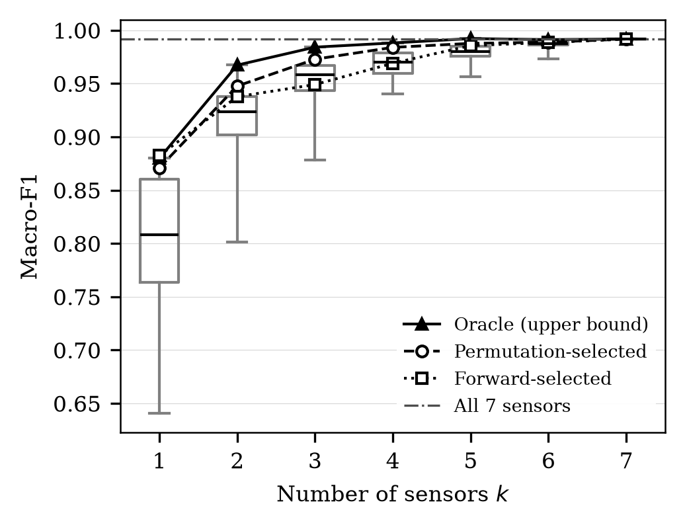

[](https://github.com/Narenkaarthik/sensor-reduction-study/actions/workflows/tests.yml)

# How Many Sensors Are Enough?

An exhaustive sensor-subset analysis for rotating machinery fault diagnosis on
the MaFaulDa dataset: one fixed Random Forest trained on every one of the 127
non-empty subsets of 7 sensors, evaluated with leakage-free cross-validation.



**Macro-F1 against sensor count, held-out speed bands.** Box plots cover all
C(7,*k*) subsets of each size; the overlaid curves are the oracle upper bound
and the two honest selection strategies. Four sensors chosen on training data
alone reach 0.984, within 0.008 of all seven. The oracle line is selected using
test scores and is an upper bound, not an achievable result.

## What this is

Instrumenting a machine costs money, wiring and maintenance, so it matters how
much diagnostic performance is lost when sensors are removed. This study
measures that on MaFaulDa (1,951 recordings, 6 fault classes, 8 channels at
50 kHz), training one fixed Random Forest on every possible sensor subset rather
than on a heuristic shortlist. Sensors are selected using training data only,
and the evaluation holds out whole rotation-speed bands so the model is tested
at speeds it never saw. Four of seven sensors reach macro-F1 0.984 against 0.992
for all seven; a single sensor reaches 0.871.

This is an empirical study, not a new method. There is no hyper-parameter
tuning, no model selection and no attempt to maximise accuracy.

## Key findings

All figures are for the primary protocol (held-out speed bands) on MaFaulDa, and
do not generalise beyond this dataset and this evaluation.

- **Four sensors are enough on this dataset.** The permutation-selected 4-sensor
  subset reaches macro-F1 0.984 ± 0.013, above the 0.9817 threshold for being
  within 0.01 of the full 7-sensor configuration (0.9917 ± 0.0066). H2 supported.
- **Removing a sensor never helped.** Neither honest selection curve rises by
  more than 0.01 at any step from *k*+1 to *k*. H1 supported on both fair curves.
- **Informed selection does not reliably beat a median subset.** H3 was **not
  supported**: the permutation-selected subset beat the per-split median at 4 of
  6 sensor counts, forward selection at 2 of 6 (one-sided Wilcoxon, n = 10,
  α = 0.05). The same verdicts hold under Holm adjustment.
- **The tachometer carries a learnable recording artefact and was excluded.** On
  67 recordings, all `ball_fault` and all labelled `underhang` or `overhang`,
  the channel separates at Cohen's *d* up to 6.6. A model given only the
  tachometer classifies those affected windows at 0.824 accuracy against 0.407
  on unaffected ones. The study therefore uses **7 sensors, not 8**.
- **That exclusion changed no conclusion.** Re-running the whole pipeline with
  the tachometer included gives identical H1 and H2 verdicts, identical oracle
  subsets at every *k*, and a permutation-selected curve matching to three
  decimal places. With the other seven sensors present the artefact is not used.

## Repository structure

```
common.py                  all constants and shared helpers; single source of truth
01_extract_features.py     raw CSV -> features/features.csv (18 features per channel)
02_checkpoint.py           leakage, baseline and sanity checks before the main run
03_run_experiments.py      selection plus all 127 subsets on every split
04_analyze.py              tables, figures, hypothesis verdicts, Level F checks
scripts/                   supplementary and diagnostic analyses, and the run script
tests/                     test levels A-F
results/<analysis>/        per-split scores, predictions and selection records
tables/<analysis>/         generated tables, including the hypothesis verdicts
figures/<analysis>/        generated figures as PDF and 300 dpi PNG
paper/                     the paper: LaTeX source, bibliography, compiled PDF
docs/                      results inventory and the commit map
```

There are three analyses, each with its own `results`, `tables` and `figures`
directory: `speed` (primary), `recording` (secondary robustness) and
`secondary_8sensor_speed` (the artefact demonstration).

## Verify in 5 minutes, without the dataset

The test suite runs on a seeded synthetic dataset built at run time, so the code
can be checked without downloading 13 GB.

```bash
python -m venv .venv
.venv/Scripts/python.exe -m pip install -r requirements-lock.txt
.venv/Scripts/python.exe -m pytest -m "not slow and not realdata" -q
```

On Linux or macOS use `.venv/bin/python` throughout. The full suite is
`python -m pytest` and takes about 7 minutes.

## Reproduce the results

1. **Get the dataset.** Download MaFaulDa from
   [the UFRJ page](https://www02.smt.ufrj.br/~offshore/mfs/page_01.html) and
   unzip it so the six class folders sit directly under `data/mafaulda/`:
   `normal`, `imbalance`, `horizontal-misalignment`, `vertical-misalignment`,
   `underhang`, `overhang`. The pipeline never downloads it.

2. **Validate the dataset** (seconds). Checks the 1,951 file count, the shape of
   a seeded 50-file sample, and the class folders.
   ```bash
   python -m pytest -m realdata -s
   ```

3. **Extract features** (about 3 minutes on 16 cores).
   ```bash
   python 01_extract_features.py
   ```

4. **Run the checkpoint** (about 5 minutes per mode). Reports leakage inflation,
   the baseline, every single-sensor model, the sanity baselines and class
   coverage per speed band.
   ```bash
   python 02_checkpoint.py --split speed
   ```

5. **Run the experiment** (about 25 minutes per mode).
   ```bash
   python 03_run_experiments.py --split speed
   python 03_run_experiments.py --split recording
   ```
   Add `--dry-run` first to measure one split and project the total. The run
   resumes if interrupted: rerun the same command and completed splits are
   skipped.

6. **Analyse** (about 1 minute per mode).
   ```bash
   python 04_analyze.py --split speed --expect-full-run
   python 04_analyze.py --split recording --expect-full-run
   ```

`scripts/run_real_study.sh` documents this sequence with the decision points
marked. It is documentation, not automation.

## Comparing your output against ours

Every random seed is fixed, so a rerun on the same data should match
**byte for byte**, not merely closely. Feature extraction is deterministic
across repeated runs and across worker counts, and the experiment is
deterministic given the same feature table.

```bash
md5sum results/speed/scores_r0_f0.csv
```

Our value is `525d01bd370efabc79e592e278f4ed6a`. If yours differs, the
difference is in the inputs or the library versions, not in sampling: compare
`requirements-lock.txt` and the `run_metadata.json` written beside every output,
which records the commit, the library versions and the command line.

Two files are expected to differ: `run_metadata.json` carries a timestamp and
measured elapsed times, and the predictions in `preds_*.npz` are compared array
by array rather than byte by byte.

## Documentation

- [PROTOCOL.md](PROTOCOL.md) — every fixed experimental decision with its
  rationale, including the three changes made after data processing began and
  why each was made on physical rather than empirical grounds.
- [docs/RESULTS_INVENTORY.md](docs/RESULTS_INVENTORY.md) — every generated table
  and figure, what it shows, and which paper section it feeds.
- [docs/COMMIT_MAP.md](docs/COMMIT_MAP.md) — the commit hashes recorded in
  `PROTOCOL.md` and in every `run_metadata.json` predate a 2026-10-31 identity
  rewrite and do not resolve in this history. This maps each one to its
  published counterpart; no tree, message or date changed.

## Environment

| | |
|---|---|
| Python | 3.14.2 |
| numpy / pandas / scipy | 2.5.3 / 3.0.6 / 1.18.1 |
| scikit-learn / matplotlib / joblib | 1.9.1 / 3.11.2 / 1.6.0 |
| Hardware | AMD64 16-core, Windows 11 |
| Feature extraction | 2 min 37 s, 1,951 recordings |
| Experiment, 7 sensors | 21-26 min per split mode (10 splits x 127 subsets) |
| Experiment, 8 sensors | 56 min (10 splits x 255 subsets) |
| Peak memory | 273 MiB |
| Test suite | 135 tests, about 7 minutes |

Exact versions are pinned in `requirements-lock.txt`. `requirements.txt` holds
the minimum constraints.

## Dataset licence

**MaFaulDa is not redistributed here.** It belongs to the Signals, Multimedia and
Telecommunications Laboratory, COPPE/Poli, Universidade Federal do Rio de
Janeiro, and must be obtained from
[their page](https://www02.smt.ufrj.br/~offshore/mfs/page_01.html) under
whatever terms they set. Nothing under `data/` or `features/` is tracked in this
repository.

## Licence

The code in this repository is released under the MIT Licence. See
[LICENSE](LICENSE).

## Citation

If you use this code, please cite the paper. Details are in
[CITATION.cff](CITATION.cff); the dataset should be cited separately, as in
`paper/refs.bib`.
